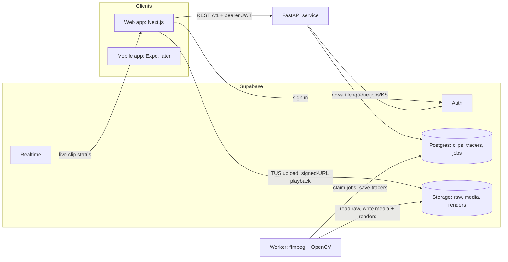

# Golf Tracer App — Build Spec

_Oct 20, 2026 · Isaac_

## How to use this doc

You are building a web app that applies a ball-flight tracer to golf swing clips, and the web app will later become a native mobile app. Build it milestone by milestone (see Milestones), shipping something runnable end to end at each step. Where this doc is silent, pick the conventional option, write the decision into `docs/DECISIONS.md`, and keep going.

Ground rules:

- **Stack is fixed:** Next.js (App Router, TypeScript/TSX, React) for the web client, Python FastAPI for the API and video processing, Supabase for Postgres, Auth, Storage and Realtime, Docker for every service we run. Use the latest stable versions at build time and pin them.
- **API-first:** every feature the web client uses goes through the FastAPI API or Supabase directly (auth, storage uploads, realtime). No business logic in Next.js server actions or route handlers, because the mobile app has to reuse it.
- **Tracer data is the product.** A tracer is a JSON document (see Tracer spec). Clients draw it as an overlay; the worker burns it into an MP4 for export. Both must produce the same curve from the same JSON.
- **Automatic tracing will sometimes fail.** Always give the user a fast manual fallback rather than a dead end.
- Ask the human before: adding a paid third-party service, changing the stack, or changing the tracer JSON schema after milestone 3.

Definition of done for each milestone: `docker compose up` brings the stack up from a clean checkout, migrations apply, tests pass in CI, the README says how to run it, and the milestone's acceptance criteria are demonstrably met.

## Product overview

A golfer uploads one or many swing clips, each containing a single shot filmed from behind, and gets each clip back with a broadcast-style tracer following the ball. They review every tracer, fix any that look wrong, then download or share the result.

Core user flow:

1. Sign in.
2. Drag in one clip or a batch of clips (or pick them from the phone's camera roll on mobile).
3. Watch clips move through Uploading → Processing → Ready for review in a library view.
4. Open a clip, play it with the tracer overlaid, and approve it or adjust it (start point, apex, landing point, curve, style).
5. Export an MP4 with the tracer burned in.

**In scope for v1:** email and OAuth sign-in, bulk upload, automatic tracing, manual tracer fallback, tracer editing, tracer styles, MP4 export, a clip library with status, delete.

**Not in v1:** face-on or side-view clips, multiple shots per clip, live capture inside the app, ball speed, carry distance or launch-angle numbers, social feeds, teams or coaching accounts, payments.

## Recording requirements

The only hard rule for users is the camera angle: the clip must be filmed from behind the golfer, looking down the target line ("down the line"). Everything else is a recommendation that improves tracer quality, shown in an onboarding screen and a help link on the upload page.

Show users these tips:

- Camera behind the golfer, roughly hand height, pointing at the target. The ball at address should be visible in the lower part of the frame.
- Use a tripod or prop the phone up. Handheld clips are accepted but trace less reliably.
- Higher frame rates help: 60 fps minimum recommended, 120 or 240 fps better.
- Leave plenty of sky above the golfer and don't zoom.
- Start recording a second or two before the swing and stop once the ball lands or disappears.

Accepted clip constraints (enforced client-side, re-checked server-side):

| Rule | Value |
| --- | --- |
| Formats | MP4, MOV (H.264 or HEVC); WebM accepted |
| Max file size | 500 MB per clip |
| Duration | 2 s to 60 s |
| Resolution | 480p minimum; downscaled to 1080p max for processing |
| Orientation | Portrait or landscape; honour rotation metadata |
| Shots per clip | Exactly one |
| Batch size | Up to 50 clips per upload batch |

The app cannot reliably verify the camera angle automatically, so it does not block uploads on it. Instead, a clip that traces with low confidence shows a hint linking to the recording tips.

## Architecture

We run three containers (web, API, worker) on top of Supabase. Clients call FastAPI for all application logic and use Supabase directly only for sign-in, file transfer and live status updates.



Video bytes never pass through the API: clients upload to and play from Storage, and only the worker reads and writes video.

| Service | Base | Role |
| --- | --- | --- |
| `web` | Node LTS, Next.js standalone output | UI only; no business logic |
| `api` | Python 3.12+ slim, FastAPI, uvicorn | REST API, auth checks, ownership, job enqueue, signed URLs |
| `worker` | Same Python base plus `ffmpeg` and OpenCV headless | Runs `process`, `retrace` and `render` jobs; scale by replicas |
| Supabase | `supabase start` (CLI local stack) in dev; hosted Supabase in prod | Postgres, Auth, Storage, Realtime |

The API and worker share one Python package, `tracer_core`, and connect to Postgres directly (`psycopg`) for the job queue; use a direct or session-mode connection so `LISTEN/NOTIFY` and `SKIP LOCKED` work. Don't containerize Supabase yourself; the CLI already runs it in Docker.

Repo layout (pnpm workspaces for TypeScript, `uv` for Python):

```
golf-tracer/
  apps/web/               Next.js app (App Router, TSX)
  services/api/           FastAPI app: routers, auth, schemas
  services/worker/        job loop entrypoint
  python/tracer_core/     pipeline, storage and DB helpers
  packages/tracer-spec/   JSON Schema, ts/ and python/ implementations, test vectors
  packages/api-client/    TS client generated from OpenAPI
  supabase/               config, migrations, seed
  datasets/golden/        labels (clips stored outside git)
  docs/DECISIONS.md
  docker-compose.yml
  .env.example
```

Environment variables: `SUPABASE_URL`, `SUPABASE_ANON_KEY` (web), `SUPABASE_SERVICE_ROLE_KEY` (API and worker only, never shipped to clients), `SUPABASE_JWT_AUDIENCE`, `DATABASE_URL`, `NEXT_PUBLIC_API_URL`, `TRACE_DEBUG`.

## Data model

Postgres in Supabase holds five tables; video files live in Supabase Storage, and every schema change ships as a migration under `supabase/migrations/`.

| Table | Purpose | Key columns |
| --- | --- | --- |
| `profiles` | One row per user, created by trigger on `auth.users` insert | `id` (= auth user id), `display_name`, `default_tracer_style` jsonb, `created_at` |
| `upload_batches` | Groups clips uploaded together so the UI can show batch progress | `id`, `user_id`, `clip_count`, `created_at` |
| `clips` | One row per uploaded video | `id`, `user_id`, `batch_id` (nullable), `original_filename`, `status` enum, `error_code`, `error_message`, `raw_path`, `normalized_path`, `thumbnail_path`, `render_path`, `duration_s`, `fps`, `width`, `height`, `size_bytes`, `approved_at`, `created_at`, `updated_at` |
| `tracers` | Versioned tracer documents per clip; edits create a new version | `id`, `clip_id`, `version` int, `source` enum (`auto`, `manual`, `edited`), `data` jsonb (Tracer spec), `confidence` numeric, `is_current` bool, `created_at`; unique (`clip_id`, `version`); partial unique index on (`clip_id`) where `is_current` |
| `jobs` | Work queue for the worker | `id`, `clip_id`, `kind` enum (`process`, `retrace`, `render`), `status` enum (`queued`, `running`, `succeeded`, `failed`), `attempts`, `max_attempts` (default 3), `payload` jsonb, `run_after`, `locked_at`, `locked_by`, `last_error`, `created_at`, `finished_at` |

Clip status lifecycle (`clips.status`):

| Status | Meaning | Moves to |
| --- | --- | --- |
| `uploading` | Row created, file still uploading | `queued`, or deleted if abandoned after 24 h |
| `queued` | Upload confirmed, `process` job waiting | `processing` |
| `processing` | Worker normalizing and tracing | `review`, `needs_input`, `failed` |
| `review` | Auto tracer produced; user hasn't approved it | `approved`, `queued` (re-trace) |
| `needs_input` | Tracking failed or confidence too low; user must place points | `review` (after manual points) |
| `approved` | User accepted the tracer | `rendering`, `review` (if edited again) |
| `rendering` | Worker burning the tracer into an MP4 | `approved` with `render_path` set, or `failed` |
| `failed` | Unrecoverable error (bad file, codec, timeout); `error_code` says why | `queued` (manual retry) |

Storage buckets, all private and read through short-lived signed URLs:

- `raw`: originals at `{user_id}/{clip_id}/original.{ext}`
- `media`: normalized video and thumbnail at `{user_id}/{clip_id}/normalized.mp4` and `thumb.jpg`
- `renders`: exports at `{user_id}/{clip_id}/render_v{tracer_version}.mp4`

Access rules:

- Row Level Security on every table. Users can read their own `profiles`, `upload_batches`, `clips` and `tracers` rows (`user_id = auth.uid()`, or via the clip for `tracers`). Writes to `clips`, `tracers` and `jobs` go through the API using the service role.
- `jobs` has no user-facing policies at all.
- Storage policies allow a user to upload only into `raw/{their user id}/...`; all other buckets are written by the worker only.
- Enable Supabase Realtime on `clips` so the library updates live as statuses change.

## API

The FastAPI service exposes a versioned REST API under `/v1`, authenticated with the user's Supabase access token as `Authorization: Bearer <jwt>`. Verify tokens in a FastAPI dependency against the Supabase project's JWT signing keys (JWKS), and reject expired or wrong-audience tokens with 401.

| Method | Path | Does |
| --- | --- | --- |
| GET | `/health` | Liveness check, no auth |
| POST | `/v1/batches` | Create an upload batch; body `{clip_count}` |
| POST | `/v1/clips` | Create a clip row (`uploading`) and return the storage path plus upload credentials; body `{filename, size_bytes, content_type, duration_s, batch_id?}` |
| POST | `/v1/clips/{id}/complete` | Confirm the upload: check the object exists, enqueue a `process` job, set `queued` |
| GET | `/v1/clips` | List the user's clips, cursor-paginated, filter by `status` and `batch_id`; includes signed thumbnail URLs |
| GET | `/v1/clips/{id}` | One clip with its current tracer and a signed playback URL for the normalized video |
| DELETE | `/v1/clips/{id}` | Delete the clip, its tracers, jobs and all stored files |
| POST | `/v1/clips/{id}/retrace` | Re-run auto tracing, optionally with hints `{ball_xy?, impact_time_s?}` |
| POST | `/v1/clips/{id}/tracer/manual` | Build a tracer from user-placed points `{impact_time_s, start, apex, landing, curve?}`; synchronous, returns the new tracer |
| PUT | `/v1/clips/{id}/tracer` | Save an edited tracer as a new version; body `{base_version, data}`; 409 if `base_version` isn't current |
| GET | `/v1/clips/{id}/tracer/versions` | Version history, for undo |
| POST | `/v1/clips/{id}/approve` | Mark approved |
| POST | `/v1/clips/{id}/render` | Enqueue a `render` job for the current tracer version |
| GET | `/v1/clips/{id}/render` | Signed download URL for the latest render |
| POST | `/v1/clips/bulk` | Bulk `approve`, `render` or `delete` for up to 50 `clip_ids` |
| PATCH | `/v1/me` | Update profile and `default_tracer_style` |

Conventions:

- Errors are `{"error": {"code": "clip_not_found", "message": "..."}}` with the right HTTP status.
- Pydantic models define every request and response. The OpenAPI schema generates a typed TypeScript client into `packages/api-client` (use `openapi-typescript`), regenerated in CI and checked for drift.
- Every query filters by the authenticated user even though the API uses the service role; never trust a client-supplied `user_id`.
- Rate-limit clip creation (e.g. 200 clips per user per hour) and return 429 with `Retry-After`.

## Upload flow

Files go straight from the client to Supabase Storage using resumable (TUS) uploads; the FastAPI service only creates records and hands out upload paths, so large videos never stream through the API.

1. User drops or picks one or more files. The client validates each file's type, size and, where the browser can read it, duration and dimensions (load metadata in a hidden `<video>`). HEVC files the browser can't decode skip the duration check; the server re-validates.
2. For two or more files, the client calls `POST /v1/batches`.
3. For each file, the client calls `POST /v1/clips` to get its storage path, then uploads with a TUS client (`tus-js-client` on web) to Supabase Storage's resumable endpoint using the user's session token.
4. When a file finishes, the client calls `POST /v1/clips/{id}/complete`, and the clip moves to `queued`.
5. The library view subscribes to Realtime changes on `clips` and updates each card's status live.

Upload UX requirements:

- Drop zone accepting multiple files plus a file picker; on mobile, the system photo picker with multi-select.
- At most 3 concurrent uploads; the rest wait in a visible queue.
- Per-file progress bar, cancel button, and automatic retry with exponential backoff (3 tries) on network errors.
- Uploads resume after a page reload or dropped connection (TUS fingerprint stored per file).
- Warn before closing the tab while uploads are in progress.
- A rejected file shows the reason inline ("Over 500 MB", "Longer than 60 s") and doesn't block the rest of the batch.
- The user can leave the upload screen and start reviewing finished clips while the rest of the batch is still processing.

## Tracer pipeline

The worker tracks the ball for as long as it is visible after impact (often well under the full flight), then fits a trajectory model to those points to estimate apex and landing. Plan for the ball to be lost against sky, trees or compression artifacts; the model, plus the user's adjustments, carries the rest of the tracer.

**Job loop.** The worker claims jobs from the `jobs` table with `SELECT ... FOR UPDATE SKIP LOCKED` (status `queued`, `run_after <= now()`), oldest first, and can use Postgres `LISTEN/NOTIFY` to wake immediately. It sets `running` and a heartbeat on `locked_at`. Failures increment `attempts` and back off via `run_after`; locks older than 10 minutes are reclaimed. One job per worker process; scale with replicas.

**Processing steps for a `process` job:**

1. **Probe** with `ffprobe`: codec, nominal and average frame rate (detect variable frame rate), rotation, duration, audio presence. Invalid or out-of-limits files go to `failed` with an `error_code`.
2. **Normalize** with `ffmpeg`: H.264 `yuv420p`, `+faststart`, rotation applied, long edge at most 1920 px, constant frame rate at the source's nominal rate (cap 240 fps), AAC audio kept. Upload to `media`. All tracer timestamps refer to this file. Run detection on a further downscaled copy (long edge about 960 px) for speed and map coordinates back.
3. **Find the ball at address.** In the pre-impact frames, find a small, roughly round, light, stationary blob in the lower part of the frame near the golfer's feet. Use a person detector to narrow the search region, a pretrained object detector (COCO `sports ball`) where it fires, and a classical fallback (blob or Hough-circle detection on bright regions). Prefer the candidate that stays put across many frames. Output `ball_xy` and radius.
4. **Detect impact.** Combine an audio onset peak (strike transient; high-pass the audio first) with the visual moment the ball leaves its address box (template match against the address-frame crop drops). If both exist and agree within about 150 ms, use the visual frame; otherwise use whichever exists. Output `impact_time_s`.
5. **Track early flight.** From impact onward, generate candidates by frame differencing or short-history background subtraction, then filter by size, brightness and shape, masking out the golfer. Handle motion blur: at low frame rates the ball is a streak, so take its leading end. Associate candidates across frames with a constant-acceleration Kalman filter, or a RANSAC/dynamic-programming search for the smoothest path that starts at `ball_xy`. In the first frames after impact, the club head is the main false positive; the ball keeps rising and shrinking while the club wraps around. Stop after about 5 consecutive missed frames or when the ball exits the frame.
6. **Fit and extrapolate.** Fit the observed points to the trajectory model in Tracer spec (start, apex, landing, curve, timing). For milestone 4, fit in image space: launch direction and curvature from the observed points; landing near an estimated horizon line (the dominant sky/ground edge, or a default fraction of frame height); flight duration from a tunable default of about 5 s. Milestone 6 replaces this with a 3D ball-flight model (launch speed and angle, azimuth, spin with drag and Magnus lift) projected through an estimated pinhole camera behind the golfer and fit by least squares, giving physically plausible extrapolation.
7. **Score confidence** (0 to 1) from address-detection score, impact-signal agreement, number of tracked frames, and fit residual in pixels. Starting thresholds, to be tuned on the test set: at least 0.7 → `review`; 0.4 to 0.7 → `review` with a "check this tracer" badge; below 0.4 or no track → `needs_input`.
8. **Save** tracer version 1 (`source = auto`), a thumbnail from just before impact, and the new status.

**Manual fallback.** In `needs_input` (or any time the user chooses), the user scrubs to impact and taps the ball, then taps the apex and the landing spot. `POST /v1/clips/{id}/tracer/manual` builds a tracer from those points using the same model. A manual tracer should take under 15 seconds to create.

**Debug output.** With `TRACE_DEBUG=1`, the worker writes a debug video showing candidates, the chosen track and the fitted curve to `media/{user_id}/{clip_id}/debug.mp4`. This is essential for tuning; build it in milestone 4.

**Libraries:** `ffmpeg`/`ffprobe`, `opencv-python-headless`, NumPy, SciPy (least squares, splines), `onnxruntime` for any detector models (keep PyTorch out of the runtime image). A trained small-ball detector, for example a TrackNet-style heatmap model trained on our own labelled clips, is a later upgrade if classical tracking plateaus; check model and library licences before adopting any.

## Tracer spec

A tracer is one JSON document, versioned with `schema_version`, that fully determines what is drawn at every moment of the clip. The web overlay, the future mobile overlay, and the worker's MP4 render all evaluate it with the same math, so the preview the user approves is exactly what they export.

```json
{
  "schema_version": 1,
  "video": { "width": 1080, "height": 1920, "fps": 120, "duration_s": 9.4 },
  "impact_time_s": 3.21,
  "apex_time_s": 5.40,
  "landing_time_s": 8.10,
  "path": {
    "start":   [0.512, 0.781],
    "c1":      [0.512, 0.164],
    "apex":    [0.538, 0.164],
    "c2":      [0.552, 0.164],
    "landing": [0.571, 0.402]
  },
  "timing": { "ascent_ease": 2.0, "descent_ease": 1.3 },
  "style": { "color": "#FF3B30", "width": 0.006, "taper": 0.4, "glow": 0.5, "persist_s": 2.0 },
  "observed": [ { "t": 3.218, "x": 0.512, "y": 0.770, "score": 0.91 } ],
  "fit": { "method": "image_v1", "residual_px": 2.1, "confidence": 0.82 }
}
```

Field rules:

- Coordinates are normalized to the normalized video's displayed frame (after rotation): `[x, y]`, origin top-left, `y` down, both in 0–1. Times are seconds on the normalized video's timeline.
- The path is two quadratic Bézier segments: `start → apex` with control `c1`, and `apex → landing` with control `c2`. `c1`, `apex` and `c2` share the same `y` (the apex is the highest point, so the screen tangent there is horizontal), which also keeps the curve smooth at the apex. Validate this on save.
- `impact_time_s < apex_time_s < landing_time_s <= video.duration_s`.
- `style.width` is a fraction of frame height so the line scales with resolution. `taper` is the end width as a fraction of the start width. `glow` is 0–1 (blur radius and opacity of an underlay stroke). `persist_s` is how long the full tracer stays after landing; `null` means until the end.
- `observed` and `fit` are diagnostic only. Renderers never read them.

Curve and timing math (`t_i`, `t_a`, `t_l` = impact, apex and landing times; `p_a`, `p_d` = `ascent_ease` and `descent_ease`; `k` = `ascent_depth_ratio`, optional, default 1):

```
B(u; P0, C, P1) = (1-u)^2 * P0  +  2(1-u)u * C  +  u^2 * P1,     u in [0, 1]

Ascent,  t_i <= t <= t_a:   tau = (t - t_i) / (t_a - t_i)
                            r   = tau / (tau + k * (1 - tau))
                            u   = 1 - (1 - r)^p_a
                            head = B(u; start, c1, apex)

Descent, t_a <  t <= t_l:   tau = (t - t_a) / (t_l - t_a)
                            u   = tau^p_d
                            head = B(u; apex, c2, landing)
```

With both eases above 1, the ball decelerates into the apex and hangs there before descending.

`ascent_depth_ratio` (0 < k ≤ 1) is the ball's distance from the camera at impact divided by its distance at the apex. A ball flying away from a down-the-line camera moves fast on screen off the club and then slows sharply, because it is receding. `k` below 1 warps ascent time that way; `k = 1` gives `r = tau`, the plain power ease. Auto tracers fit both values. An ease near 0.5 cancels the Bézier's own slow-down toward the apex, so the screen height follows the receding ball closely.

Drawing rules at video time t: before impact, draw nothing; from impact to landing, draw the path from `start` up to the head; after landing, draw the full path until `persist_s` runs out, then fade over 0.3 s. Renderers sample each segment at 200 evenly spaced `u` values, convert to pixels by multiplying by the frame's width and height, and stroke the polyline with width interpolated linearly from `width` to `width × taper` along the path.

Keep the JSON Schema, a TypeScript implementation and a Python implementation in `packages/tracer-spec/`, with shared test vectors (spec + times + expected head positions and sampled points). Both implementations must match the vectors to within 1e-6, enforced in CI.

## Review & editing UI

Reviewing should be fast enough to get through a batch of 20 clips in a few minutes: open the queue, watch each tracer, approve or nudge it, move on.

**Library screen**

- Grid of clip cards: thumbnail, filename, upload date, status badge, and a "check this tracer" badge for medium-confidence clips. Live status via Realtime.
- Filter by status and batch; sort newest first.
- Multi-select for bulk approve, export and delete.
- A **Review queue** button that opens the first clip in `review` or `needs_input` and steps through the rest.

**Review screen**

- Video player on the normalized video, with a `<canvas>` overlay sized to the video's displayed box (scaled by `devicePixelRatio`). Redraw on every frame using `requestVideoFrameCallback`, falling back to `requestAnimationFrame` plus `currentTime`. Draw with the TypeScript implementation from `packages/tracer-spec`, drawing glow as a wider low-opacity underlay stroke so it matches the server render.
- Controls: play/pause, single-frame step, 0.25× / 0.5× / 1× speed, a scrub bar with markers at impact, apex and landing, and a tracer on/off toggle.
- Actions: Approve, Edit, Re-trace, Export, Delete, and Previous/Next in the queue.

**Edit mode**

- Draggable handles on the frame for `start`, `apex` and `landing`; dragging `apex` moves `c1` and `c2` with it so their `y` stays equal. An "advanced" toggle exposes `c1` and `c2` as handles to change the launch shape.
- Draggable timeline markers for impact, apex and landing times.
- Style panel: colour presets (red, yellow, white, blue) plus a custom colour, width, glow, taper, persist duration, and "Save as my default".
- Local undo/redo; Save creates a new tracer version (`source = edited`); Revert restores any earlier version.
- Touch targets at least 44 px so the same components work on phones.

**Needs-input wizard** (for clips in `needs_input`, or launched from Edit): three steps with a live preview. Step 1: scrub to impact (pre-set to the detected impact if any) and tap the ball. Step 2: tap where the ball peaked. Step 3: tap where it landed. The preview appears as soon as step 3 is done, already in edit mode.

**Keyboard shortcuts** on desktop: Space play/pause, ←/→ frame step, A approve, E edit, R re-trace, N / P next / previous clip, Ctrl/Cmd+Z undo.

## Rendering and export

A `render` job burns the current tracer into a copy of the normalized video and stores it in `renders`; the user downloads it through a signed URL.

- Decode frames with PyAV or OpenCV, draw the tracer per frame with the Python implementation from `packages/tracer-spec` (anti-aliased polyline, tapered width, glow underlay), and encode H.264 with the original audio muxed back in via `ffmpeg`.
- Draw at the video's full normalized resolution, not the detection resolution.
- Output name `render_v{tracer_version}.mp4`; re-exporting an unchanged tracer reuses the existing file.
- Target: under 60 s to render a 15 s 1080p clip on a 4-core CPU worker.
- A small "Traced with <app name>" watermark is a config flag, off by default.
- Visual parity check in CI: render a test-vector clip on the server, draw the same frame with the TypeScript renderer in a headless browser, and require the pixel difference to stay under a small threshold.

## Mobile-readiness rules

The native app will most likely be React Native with Expo, reusing the API, the tracer spec and the typed API client; build the web app now so nothing has to be re-architected later.

- All business logic lives in FastAPI or the worker. Next.js only renders UI and calls the API and Supabase.
- Shared TypeScript packages (`api-client`, `tracer-spec`, shared types and validation) must have no DOM or Next.js imports, so React Native can consume them.
- Uploads use the TUS protocol, which has React Native clients, and the same `POST /v1/clips` → upload → `complete` sequence.
- Auth uses Supabase sessions and bearer tokens only; no cookie-only auth paths the mobile app can't use.
- Keep UI components split into presentation and logic hooks (`useClipUpload`, `useTracerEditor`, `useReviewQueue`) so the hooks can be ported.
- Responsive, touch-first layouts from day one; the web app should work well in a phone browser.
- Later mobile-only features (in-app capture with an alignment guide, background uploads, push when a batch finishes) only add clients of the existing API.

## Testing and quality metrics

Tracer quality is measured against a labelled set of real clips, and every pipeline change is judged by those numbers rather than by eyeballing a few videos.

**Golden dataset.** At least 50 real down-the-line clips covering phones, frame rates (30/60/120/240), lighting, backgrounds (sky, trees), tripod and handheld, and clubs from wedge to driver. Each is labelled with the address ball position, impact frame, ball position on every frame where it's visible, and approximate landing point. Store clips outside git (a private storage bucket) with labels as JSON in `datasets/golden/`. Build a labelling mode into the editor (click the ball frame by frame) rather than a separate tool.

**Evaluation.** `python -m tracer_core.eval` runs the pipeline on the golden set and reports:

| Metric | What it measures |
| --- | --- |
| Address detection rate | Ball found within 2 radii of the label |
| Impact error | Frames between detected and labelled impact |
| Track recall | Share of labelled visible frames with a tracked point |
| Track error | Mean pixel distance from labelled positions |
| Landing error | Distance from labelled landing, as a fraction of frame height |
| Confidence calibration | Whether low-confidence clips really are the bad ones |
| Route rate | Share of clips going to `review` vs `needs_input` |

Record a baseline when milestone 4 lands; CI fails if any metric regresses beyond a set tolerance.

**Other tests**

- Python: `pytest` for API routes (auth, ownership, validation), job queue behaviour (locking, retries, stale locks) and pipeline units.
- TypeScript: `vitest` for `tracer-spec`, hooks and the API client.
- End to end: Playwright runs sign-in → bulk upload → processing → review → edit → approve → export, using short fixture clips.
- Shared tracer-spec test vectors and the render parity check (see Rendering and export).
- CI on GitHub Actions: `ruff` and `mypy`, ESLint and `tsc`, all tests, OpenAPI client drift check, Docker image builds.

## Milestones

Build in this order; milestone 3 deliberately ships manual tracing before auto tracing, so the whole product works end to end before the hardest part is tackled.

1. **Scaffold.** Monorepo, Docker Compose, local Supabase, CI, `/health`, Next.js shell, and `tracer-spec` with schema, both implementations and test vectors.
   - Accept: `docker compose up` on a clean checkout serves a page that calls `/health`; CI green.
2. **Auth, upload, library.** Sign-in, bulk resumable uploads, clip rows and `complete`, Realtime library, delete. Worker probes and normalizes, makes a thumbnail, then sets `needs_input`.
   - Accept: 20 clips uploaded in one go all reach `needs_input` with playable normalized video; a reload mid-upload resumes.
3. **Manual tracer, review, export.** Needs-input wizard, overlay renderer, edit mode, versions, approve, `render` jobs, download.
   - Accept: any clip can be traced by hand and exported in under a minute; the render parity test passes.
4. **Auto tracing v1.** Address detection, impact detection, early-flight tracking, image-space fit, confidence routing, debug video, golden dataset and evaluation.
   - Accept: evaluation runs in CI with a recorded baseline; impact within 2 frames and address detection correct on at least 90% of golden clips.
5. **Review speed and polish.** Review queue, shortcuts, bulk actions, styles and defaults, recording-tips onboarding, clear error states, phone-browser layout.
   - Accept: reviewing a 20-clip batch of well-traced clips takes under 5 minutes.
6. **Tracking v2.** Camera-motion compensation for handheld clips, the 3D ball-flight fit, and a learned detector if the evaluation shows classical tracking has plateaued.
   - Accept: landing error and route rate improve on the golden set with no metric regressing.
7. **Hardening and mobile prep.** Rate limits, retention and abandoned-upload cleanup, structured logging, a 50-clip batch load test, an RLS review, and an Expo spike that signs in, uploads and plays a tracer using the shared packages.
   - Accept: the Expo spike runs on iOS and Android against the same API.

## Open questions

These are for the human to decide; until they do, build with the default in brackets and record it in `docs/DECISIONS.md`.

- [ ] Production hosting for the web app, API and worker, and whether the worker gets a GPU [any Docker host; CPU-only worker].
- [ ] Hosted Supabase or self-hosted in production [hosted].
- [ ] How long to keep original uploads [keep originals 30 days after approval, keep renders indefinitely].
- [ ] App name, branding and whether exports carry a watermark [placeholder name; watermark off].
- [ ] Where the golden dataset clips come from, and whether users can opt in to letting their clips improve tracking [team-recorded clips only; no use of user clips].
- [ ] Free-tier limits such as clips per month or max length [none in v1 beyond the upload rules].
- [ ] Public share links for exported clips in v1 [no; download only].
